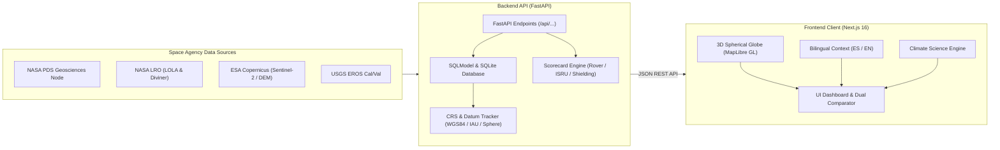

<div align="center">

# 🪐 AnalogX — Planetary Analog Discovery Engine

**NASA Space Apps Challenge 2026 · Official Submission**  
*Challenge: Identify Earth Locations that Analog Permanent Moon Base Locations and Mars*  
**Team:** AstroCapis

[](https://www.spaceappschallenge.org/)
[](https://nextjs.org/)
[](https://react.dev/)
[](https://www.typescriptlang.org/)
[](https://github.com/herlinaguileras/backend_analogX)
[](LICENSE)

</div>

---

## 🔗 Connected Repositories (Full-Stack Architecture)

> [!IMPORTANT]
> The NASA Space Apps Challenge submission portal allows submitting **one primary link**. This repository hosts the full interactive frontend client. The high-performance scientific backend API is publicly available at:

* 🖥️ **Frontend Client (This Repository):**  
  [https://github.com/herlinaguileras/frontend_analogX](https://github.com/herlinaguileras/frontend_analogX)
* ⚡ **Backend REST API & Scientific Database:**  
  [https://github.com/herlinaguileras/backend_analogX](https://github.com/herlinaguileras/backend_analogX)

---

## 📖 Project Overview

Preparing permanent human settlements on the Moon (**Artemis Base Camp**) and pioneering robotic/crewed missions to **Mars** demands rigorous terrestrial proving grounds. Historically, analog site selection has suffered from visual confirmation bias—assuming that a red landscape or a barren plain behaves like another planet without auditing physical and environmental parameters.

**AnalogX** is an open-science planetary intelligence platform and comparative engine. It parametrically cross-examines **15 audited Earth analog environments** across 5 continents against **6 high-priority extraterrestrial destinations** on the Moon and Mars.

### 🌟 Key Innovations & Features

1. **360° 3D Spherical Earth Globe (`/earth`):**
   - High-fidelity spherical globe projection powered by MapLibre GL JS.
   - Triple basemap telemetry: High-resolution **Esri World Imagery**, continuous **World Shaded Relief** (hypsometric elevation), and cartographic overlays.
   - Interactive country selector (177 nations) and physical phenomena filters (*UV Radiation*, *Cryogenic Ice*, *Hyperaridity*, *Lava Tubes*, *Altimetry & Rovers*).
   - Floating HUD technical dossiers and printable full-length scientific qualification reports.

2. **Dual-World 1:1 Terrain Comparator (`/explore`):**
   - Interactive 50/50 split scrubber aligning orbital laser altimetry (**NASA LOLA & MOLA**) directly against Earth digital elevation models (**Copernicus DEM-GLO-30 & USGS**).
   - Calibrated 5 km topographic cross-section transects (slope gradients, RMS micro-roughness, wheel sinkage hazard).
   - Strict body isolation presets for Lunar and Martian targets.

3. **Multidomain Climate & Atmospheric Engine:**
   - 4-quadrant comparative matrix evaluating extreme diurnal thermal regimes (-233 °C to +120 °C on Moon vs terrestrial extremes), barometric pressure deltas (from lunar ultra-vacuum to 500 hPa at Licancabur), sterilizing solar UV index, and eolian desiccation.

4. **"Surprise Us" Scientific Rubric (NASA Criterion):**
   - Bridges canonical global benchmarks (**Atacama Desert**, **McMurdo Dry Valleys**, **Haughton Impact Crater**, **Lanzarote Lava Tubes**) with the untapped, extreme high-altitude natural laboratories of the **Bolivian Altiplano (>3,600 to 5,900 m a.s.l.)**:
     - *Salar de Uyuni:* World's largest hyperflat reference (<0.05° slope) for lunar/martian landing Doppler radar and LiDAR altimeter calibration.
     - *Sol de Mañana (4,850 m):* World's highest acid-sulfate hydrothermal system, mirroring opaline silica sinters at Home Plate, Gusev Crater.
     - *Licancabur Summit (5,916 m):* World record solar UV-B irradiance combined with nocturnal cryogenic freeze for EVA suit polymer stress trials.
     - *Lípez Volcanic Caves:* Basaltic lava conduits providing >95% attenuation of cosmic radiation (GCR/SPE) matching Marius Hills lunar skylights.

5. **Epistemological Rigor (Where the Analogy Fails):**
   - Programmatically audits physical boundaries: explicitly documenting gravitational divergence (1g vs 0.166g Moon vs 0.38g Mars), atmospheric differences (oxygenated air vs 6 hPa CO2 or hard vacuum), and biological background limits.

6. **Global Bilingual Translation System:**
   - Persistent, instantaneous **[ ES | EN ]** language toggle synchronized across all pages, components, HUD dossiers, and printable reports.

---

## 🏛️ Fullstack Architecture



- **Frontend Repository:** [github.com/herlinaguileras/frontend_analogX](https://github.com/herlinaguileras/frontend_analogX)
- **Backend Repository:** [github.com/herlinaguileras/backend_analogX](https://github.com/herlinaguileras/backend_analogX)

---

## 🛰️ NASA & Partner Datasets Used

| Resource | Mission / Instrument | Application in AnalogX | Link |
| :--- | :--- | :--- | :--- |
| **NASA PDS Geosciences** | CRISM, THEMIS, Viking, Phoenix | Mineralogical composition, chlorides, and perchlorate soil chemistry | [pds.nasa.gov](https://pds.nasa.gov/) |
| **NASA LRO** | LOLA & Diviner Radiometer | 20m/px polar elevation models and 40 K thermal cold traps at Shackleton | [pds-geosciences.wustl.edu](https://pds-geosciences.wustl.edu/missions/lro/) |
| **NASA Solar System Treks** | Moon Trek & Mars Trek | Direct orbital coordinate deep-links to extraterrestrial landing targets | [trek.nasa.gov](https://trek.nasa.gov/) |
| **USGS Astrogeology & EROS** | EROS Cal/Val Portal | Terrestrial calibration points and high-precision surface albedo reflectance | [calval.cr.usgs.gov](https://calval.cr.usgs.gov/) |
| **ESA Copernicus** | Sentinel-2 MSI & COP-DEM-GLO-30 | 30m global digital elevation models and multispectral land cover | [dataspace.copernicus.eu](https://dataspace.copernicus.eu/) |
| **CSA RADARSAT** | RADARSAT-1 & RCM Archive | Polarimetric radar signatures for subsurface ice and permafrost detection | [donnees-data.asc-csa.gc.ca](https://donnees-data.asc-csa.gc.ca/) |

---

## 💻 Tech Stack

- **Frontend:** Next.js 16.4 (App Router), React 19, TypeScript (strict mode), MapLibre GL JS, Tailwind CSS, Turbopack.
- **Backend:** Python 3.14, FastAPI, SQLModel, Uvicorn, SQLite3, Pydantic v2. ([View Backend Repo](https://github.com/herlinaguileras/backend_analogX))
- **Cartography:** Esri World Imagery, Esri Shaded Relief, OpenStreetMap, Proj4.
- **Testing:** Playwright, Node.js Test Runner, TypeScript Typecheck (0 errors).

---

## 🚀 Getting Started

### Prerequisites
- Node.js 20+ or 22+
- npm or pnpm
- Python 3.11+ (if running the backend locally)

### 1. Frontend Setup (This Repository)

```bash
# Clone the repository
git clone https://github.com/herlinaguileras/frontend_analogX.git
cd frontend_analogX

# Install dependencies
npm install

# Setup environment variables
cp .env.example .env.local

# Run development server
npm run dev
```

Open [http://localhost:3000](http://localhost:3000) in your browser.

### 2. Backend Setup ([Backend Repository](https://github.com/herlinaguileras/backend_analogX))

```bash
# Clone the backend repository
git clone https://github.com/herlinaguileras/backend_analogX.git
cd backend_analogX

# Setup virtual environment
python -m venv .venv
source .venv/bin/activate  # Or .venv\Scripts\activate on Windows

# Install dependencies and launch API
pip install -r requirements.txt
uvicorn app.main:app --reload --port 8000
```

The backend REST API will be available at [http://localhost:8000/docs](http://localhost:8000/docs).

---

## 👥 Team AstroCapis

- **Bernardo Chavez Padilla** — Full Stack Developer & System Architect
- **Kelly Alisson Duran Marcelo** — UX/UI Lead & Product Designer
- **Susan Michel Martinez Alanoca** — Planetary Geology & Mission Research
- **Herlin Daniel Aguilera Suarez** — UX Designer & Creative Director
- **Rey Franco Velasquez Aguirre** — UI Designer & Visual Systems

---

## 📄 License

This project is open-source and available under the [MIT License](LICENSE).
NASA Space Apps Challenge 2026.
